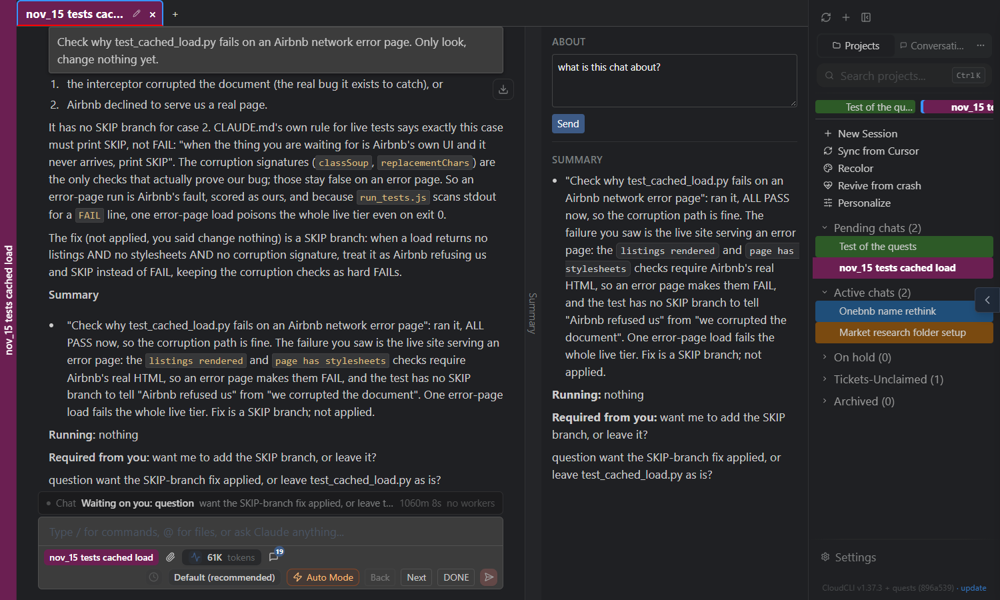
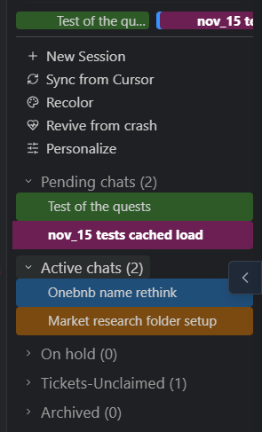
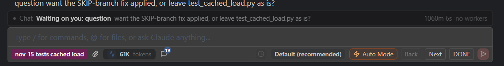

# quests

One page for all your Claude Code chats. It shows which chats wait for you, which are running, and which are done,
so you stop hunting through tabs and terminals.

It runs on your own machine. It reads the chats Claude Code already saves, wherever you started them: Cursor, a
terminal, the Claude desktop app, or the page itself.



## What you get

- **A queue.** Every chat on the machine in one list. The chats that wait for you are on top, under "Pending chats".
  Every other chat is under "Active chats", the running ones last.
- **Chats that say what they need.** In a repo with quests on, every reply ends the same way: a short summary, what
  is running, what is required from you, and one status line (`question`, `waiting for`, `blocker` or `Done`). The
  queue reads that line. You read the three lines above it and know what to do without scrolling.
- **Named chats.** A new chat first asks you to confirm its name, like `nov_15 backend login fix`, so the list stays
  readable.
- **Tabs and split screen.** Open chats as tabs, two panes side by side. One dot per chat: blue waits for you, green
  is running, orange finished while you were away.
- **Answer from the page.** Start a chat, send a message, answer a question, or approve a permission prompt. A chat
  that runs in Cursor shows its permission prompt on the page too, with one click to bring its Cursor tab to the front.
- **Tickets, if you want them.** Point it at a GitHub repo and its open issues join the queue. A chat can claim one.
- **A closing routine.** `/quests:finalize-chat` runs your repo's closing steps (for example: tests, commit, push).

## Install

You need Node 22 or newer, Python 3, and Claude Code. On Windows you also need Git Bash, which Claude Code needs
there anyway. You need `gh`, logged in, only for tickets.

```
git clone https://github.com/salomonskinoam/quests.git && cd quests
npm install
npm run build
bash scripts/start-local.sh
claude plugin marketplace add "$PWD"
claude plugin install quests@quests --scope user
```

The page is at http://localhost:3001. `start-local.sh` keeps running; leave its terminal open. The two `claude`
lines install the plugin that gives chats their ending and their name question. Run them once, in a second terminal.

## First use

1. Open http://localhost:3001 and create the account. There is one account per server, and it stays signed in.
2. You already see every chat on the machine. Nothing else is required.
3. The sidebar shows a line for repos where quests is off. Click **Turn on** for a repo. This writes a small
   `quests.json` file in that repo. New chats there get the reply ending and the name question; chats that were
   already open do not.
4. Click **Personalize** to set your name, your time zone, a tickets repo, and each repo's areas and closing steps.

## Using the queue

The queue is the sidebar. Its job is to hand you the next chat that needs you, so you never pick one by hand.



**The five drawers.** Every chat is in exactly one.

| Drawer | What is in it |
|---|---|
| Pending chats | What needs you now: a permission prompt, a `question`, or a `Done` you have not approved. Open by default. |
| Active chats | Every other chat. The running ones are last: they need nothing from you. |
| On hold | Chats you put aside. A chat comes back by itself when it replies again. |
| Tickets-Unclaimed | Open tickets no chat works on yet. Only with a tickets repo. |
| Archived | Chats you are done with, newest first. |

**Your order is the priority.** Drag a line up or down. The order is kept: a chat that leaves Pending and later
returns comes back to its place. Hover a line for its buttons: move it to the queue's end, put it on hold, archive
it, rename it. Hovering also says why the chat sits in its drawer.

**Next.** The **Next** button beside the input box, or Alt+Enter, opens the highest chat in Pending that is not the
one on screen. Alt+Enter with text typed sends the text first, then moves on. So the loop is: read the ending,
answer, Alt+Enter, repeat until Pending is empty.



**DONE.** For a chat whose work you accept. It asks whether to finalize first: Yes sends `/quests:finalize-chat`
to the chat (your repo's closing steps), then hides the chat and opens the next one. No only hides it and opens the
next one.

**The status line** above the input box says what the chat on screen is doing: "Waiting on you: question ...",
"Running a tool ...", or how long the turn has run.

**The Summary drawer.** The thin "Summary" strip between the chat and the queue. Click it to keep the last reply's
Summary, Running and Required from you in view while you scroll the chat. Its "About" box asks a side question
about the chat ("what is this chat about?") in a copy of the conversation, so the chat itself is not disturbed.

## Settings

Everything is optional. The Personalize form writes the rows marked "form". The rest are files you edit.

| Where | Key | What it does | Default |
|---|---|---|---|
| `~/.config/quests/user.env` | `QUESTS_USER` (form) | your name, as the chats address you | your login name |
| | `QUESTS_TZ` (form) | time zone of the times shown, like `Europe/Paris` | the system's |
| | `TICKETS_REPO` (form) | GitHub repo `owner/name` whose open issues join the queue; set it up once with `quests/bin/quests-init-tickets owner/name` | none: the queue holds chats only |
| | `QUESTS_HOME` | the quests checkout the plugin's hooks run from | the folder given to `claude plugin marketplace add` |
| `<repo>/quests.json` | the file itself (form) | turns quests on for that repo; `{}` is enough | off |
| | `areas` (form) | a command printing the repo's areas, one per line; an area is the second word of a chat name | one area, `general` |
| | `finish` (form) | a markdown file with the repo's closing steps | commit the chat's changes, no push |
| | `finish_command` (form) | the command that is the last closing step | none |
| | `drawer_question` (form) | the first question the Summary drawer offers | none |
| `~/.config/quests/<instance>.env` | `SERVER_PORT` | the page's port | `3001` |
| | `PROJECT_ROOTS` | the repos this server shows, `:`-separated (`;` on Windows) | every repo |
| | `DATABASE_PATH` | the server's database | `~/.config/quests/<instance>.db` |
| | `QUESTS_UNIT_PREFIX` | names its chat processes | `quests` (`quests-<instance>` for another server) |
| | `QUESTS_CHECKOUT` | the checkout this server runs from | this one |

One server is enough for any number of repos. A second server, with its own port, account and repos, is one more
`<instance>.env` file and `bash scripts/start-local.sh <instance>`.

## How a chat reports its status

Nothing is hidden and no repo needs its own prompt file. The plugin gives each chat of a quests repo the format at
its start, and checks each reply when it ends. A reply without the ending is sent back once, to add the ending only.

```
**Summary**
- "can you fix the login?": fixed, the session cookie was dropped on redirect.

**Running:** nothing

**Required from you:** try to log in once.

question does the login work for you now?
```

The last line is the status. `question` and `Done` put the chat under Pending chats. `waiting for` and `blocker`
keep it under Active chats while it still runs.

## Good to know

- The server listens on this machine only (127.0.0.1).
- Tested on Windows 11 and on Ubuntu. macOS uses the same code paths as Windows for its processes, but nobody has
  run it there yet.
- Starting at login and the in-app Update button work on Linux with systemd only. Elsewhere, start it with
  `bash scripts/start-local.sh` and update with `git pull && npm install && npm run build`.
- A chat that is open in Cursor is read live, but messages to it are sent in Cursor, so one chat never has two
  processes.

## More

- How it is built: [quests/README.md](quests/README.md)
- The contract between quests, you and a repo: [quests/INTERFACE.md](quests/INTERFACE.md)

License: AGPL-3.0-or-later. Built on CloudCLI UI (siteboon/claudecodeui); see [NOTICE](NOTICE).
